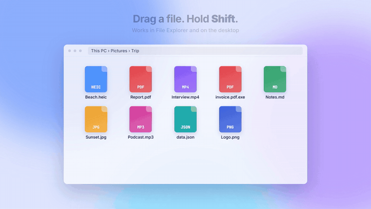

<div align="center">


# ShiftDrop

**Shift + drag any file. Pick what to do with it. Done.**

A glass wheel opens around the file you are dragging, with the actions that make sense for that
kind of file: convert, compress, crop, sign, transcribe, check, share. Everything runs on your PC.

[**Download for Windows**](https://github.com/nhaajtt/shiftdrop/releases/latest) ·
[Website](https://shiftdrop.nhaajt.com) ·
[Watch the intro](docs/media/intro.mp4) ·
[Full tour](docs/media/demo.mp4)



</div>

---

## How it works

1. Start dragging a file in File Explorer or on the desktop.
2. Hold **Shift**. The wheel opens around the file.
3. Drop it on an action. The result is saved next to the original, which is never changed.

Prefer the keyboard? While the wheel is open, press **1–8** to pick a wedge, **Esc** to cancel.
Everything else is one search away under **More**.

## What it can do

| Files | Actions |
|---|---|
| **Images** (PNG, JPG, WebP, AVIF, HEIC, RAW…) | Convert, compress, resize, rotate, crop, add a background, redact, remove metadata, copy text (OCR), read QR codes, app icons and favicons, colour palette, watermark, trace to SVG, contact sheet, slideshow video, remove background*, blur faces*, upscale 2×/4×* |
| **Video** | Convert (MP4, MOV, WebM, MKV, GIF…), compress, **fit to a size limit** (8/10/25/50 MB), resize, trim, merge, extract audio, mute, speed, flip, rotate, frames, thumbnail, fix sound, subtitles from speech* |
| **Audio** | Convert, compress, fit to size, trim, merge, speed, denoise, normalise loudness, transcribe* |
| **PDF** | To images, compress, split, merge, rearrange/rotate/delete pages, sign, page numbers, watermark, text (with OCR for scans), extract images, password protect/unlock* |
| **Documents** | Word/Excel/PowerPoint to PDF, Markdown to Word (uses Microsoft Office or LibreOffice if installed) |
| **Text & data** | To PDF/HTML, JSON ⇄ YAML ⇄ TOML, XML → JSON, CSV ⇄ JSON, pretty/minify, compare two files, QR code, Base64, translate and summarise (your Claude API key) |
| **Programs** (.exe, .dll) | Open in x64dbg/IDA/Ghidra/Binary Ninja/DIE…, PE report with imphash and section entropy, signature check, strings, capa*, FLOSS*, UPX unpack*, Windows Sandbox |
| **Any file** | Real type check (catches `invoice.pdf.exe`), hashes, VirusTotal lookup by hash, encrypt (age), shred, who is using it, copy path as WSL/URL/Markdown, zip, send to a phone over Wi-Fi, upload to your Cloudflare R2 |

\* Optional add-ons, downloaded from their official releases only when you ask, in Settings › Add-ons.

### Also

- **Learns your habits.** Actions you use climb onto the wheel; the rest stay under More.
- **Recipes.** Chain actions (e.g. *Resize 50% → JPG → Remove metadata*) and use them like any other action.
- **Watched folders.** New files in a folder (Downloads, Screenshots…) get a recipe automatically.
- **Your own commands.** Run any command line on the file, with `{file}`, `{stem}`, `{ext}` filled in.
- **Shelf.** Collect files from different folders, drag them all out together.
- **Quick look.** <kbd>Ctrl</kbd>+<kbd>Space</kbd> in Explorer previews images, video, PDFs and text.
- **Undo** from the notification, **drag the result** straight into a chat or email.
- **Right-click menu** entry, batch rename, paste files or screenshots with <kbd>Ctrl</kbd>+<kbd>V</kbd>.
- English and Vietnamese, light and dark.

## Privacy

ShiftDrop works offline. Nothing is uploaded unless you choose an action that says so:

| Reaches the internet | When |
|---|---|
| GitHub / Hugging Face | Only when you press *Download* on an add-on |
| VirusTotal | *VirusTotal* sends the file's SHA-256, never the file |
| Claude API | *Translate* / *Summarize* send that text file with your own key |
| Your Cloudflare R2 bucket | *Upload link* |
| Devices on your Wi-Fi | *To phone* serves one file at a secret link for 10 minutes, on your local network only |

API keys are encrypted with Windows DPAPI, readable only by your Windows account.

## Install

Download `ShiftDrop_x.y.z_x64-setup.exe` from [Releases](https://github.com/nhaajtt/shiftdrop/releases/latest) and run it.
No admin rights needed. Windows SmartScreen may warn about a new app: choose **More info → Run anyway**.

Requires Windows 10 or 11 (64-bit). A macOS version is planned.

## Build from source

Requirements: [Rust](https://rustup.rs) (stable, MSVC), [Node.js](https://nodejs.org) 20+, Visual Studio Build Tools (C++).

```powershell
git clone https://github.com/nhaajtt/shiftdrop
cd shiftdrop
npm install
./scripts/fetch-pdfium.ps1      # puts pdfium.dll in src-tauri/resources/bin
npm run tauri dev               # run
npm run tauri build             # installer in src-tauri/target/release/bundle/nsis
```

Engine tests (need `ffmpeg` on PATH): `cd src-tauri && cargo test --lib`.

## Project layout

```
src/                 web UI: wheel (overlay), hub, toast, shelf, preview, editors
src-tauri/src/
  win.rs             mouse + keyboard hooks (Shift-drag, number keys, Ctrl+Space)
  explorer.rs        reads the files being dragged from Explorer (COM)
  windows.rs         windows: wheel, hub, toast, shelf, preview, editors
  jobs.rs            job queue
  engines/           image, media (FFmpeg), pdf, office, text, files, security, ai, dev
  watch.rs           watched folders
  share.rs           Wi-Fi sharing, R2 upload, Claude
```

Built with [Tauri 2](https://tauri.app), Rust and plain JavaScript.

## License

[MIT](LICENSE). Third-party components and add-ons keep their own licenses: see [THIRD-PARTY.md](THIRD-PARTY.md).

---

<details>
<summary><b>Tiếng Việt</b></summary>

**ShiftDrop**: bắt đầu kéo một file trong File Explorer, nhấn giữ **Shift**, một vòng tròn kính hiện quanh file
với các thao tác hợp với loại file đó (chuyển định dạng, nén, cắt, ký PDF, tạo phụ đề, kiểm tra file giả đuôi, gửi sang điện thoại…).
Thả vào ô nào là làm việc đó, file mới nằm cạnh file gốc. Mọi thứ chạy trên máy, không tải file lên đâu cả trừ khi bạn chọn.

Tải bản cài ở mục [Releases](https://github.com/nhaajtt/shiftdrop/releases/latest). Nếu Windows cảnh báo, chọn **More info → Run anyway**.
Giao diện có tiếng Việt (Cài đặt › Ngôn ngữ).

</details>
